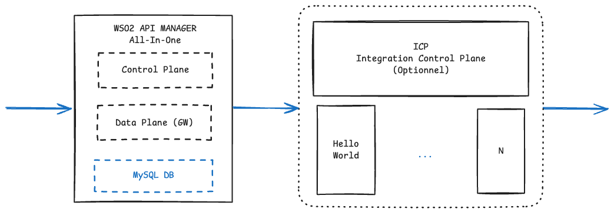
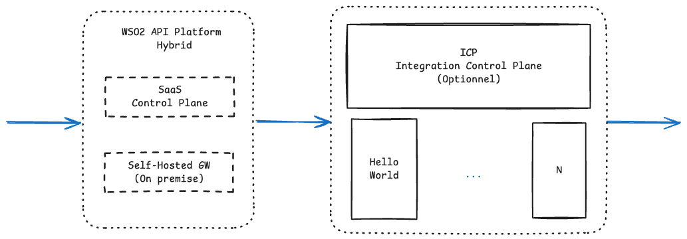

# Sample Demo iPaaS

This repository provides a ready-to-run environment for a **POC integration
platform (iPaaS)**, combining:

- **WSO2 API Platform** — two deployment modes are available in this POC:
  - **api-manager**: Full On-premise API Manager (Control Plane and Data
    Plane all-in-one)
  - **saas / hybrid**: SaaS API Platform (Control Plane on SaaS, Data Plane
    on premise)
- **WSO2 Integrator** — lightweight integration engine used to develop and
  expose integration services (connectors, transformations, orchestrations)
  as APIs.

Everything is **fully containerized with Docker**, with no need for a
Kubernetes cluster or a dedicated VM: a machine (or server) with Docker
installed is enough to run the whole POC end to end.

## Table of contents

- [Sample Demo iPaaS](#sample-demo-ipaas)
  - [Table of contents](#table-of-contents)
  - [Architecture](#architecture)
  - [Deployment modes](#deployment-modes)
  - [Repository structure](#repository-structure)
  - [Prerequisites](#prerequisites)
  - [Configuration (`.env`)](#configuration-env)
  - [Setup \& launch](#setup--launch)
    - [Step 0 — `saas` / `hybrid` mode only: get the connection token](#step-0--saas--hybrid-mode-only-get-the-connection-token)
    - [Step 1 — Start the platform](#step-1--start-the-platform)
    - [Step 2 — Verify the platform is up](#step-2--verify-the-platform-is-up)
  - [Stopping the platform](#stopping-the-platform)
  - [Going further](#going-further)
  - [POC scope](#poc-scope)
  - [Documentation](#documentation)
    - [Integration Platform](#integration-platform)
    - [API Manager (Full on-premise)](#api-manager-full-on-premise)
    - [API Platform (SaaS)](#api-platform-saas)

## Architecture

**Mode 1 - Full On-premise API Manager**



**Mode 2 - SaaS / Hybrid API Platform**



In both modes, WSO2 API Manager (or the Self-Hosted Gateway) and the WSO2
Integrator integrations share the same Docker network (`ipaas-network`),
which lets you **publish a WSO2 Integrator integration as an API backend**
in the WSO2 Publisher, simply referencing it by its container name (e.g.
`http://hello-world:9095`).

## Deployment modes

The repository offers two independent modes for the API management part,
to pick depending on what you want to demonstrate:

| Mode | Folder | Description |
|---|---|---|
| **api-manager** (default, aliases: `on-prem`, `full-on-prem`) | [`apim/api-manager/`](apim/api-manager) | Full WSO2 API Manager (Publisher, DevPortal, Gateway, Admin) self-hosted on Docker, no cloud dependency. |
| **saas** / **hybrid** | [`apim/saas-hybrid-gateway/`](apim/saas-hybrid-gateway) | Control plane (API management/publishing) hosted by WSO2's SaaS Integration Platform; only the Gateway (the component that routes API traffic) is deployed locally in Docker. |

`./start.sh` and `./stop.sh` at the root drive **both** modes via the
`--mode` flag (`api-manager` by default, or `saas` / `hybrid`). In both
cases, the [`integrations/`](integrations) part (WSO2 Integrator) stays
identical and starts automatically with `./start.sh`.

## Repository structure

| Folder | Contents |
|---|---|
| [`apim/api-manager/`](apim/api-manager) | `api-manager` mode (aliases: `on-prem`, `full-on-prem`): "all-in-one" Docker Compose install of WSO2 API Manager backed by MySQL, with data persistence on Docker volumes. |
| [`apim/saas-hybrid-gateway/`](apim/saas-hybrid-gateway) | `saas` / `hybrid` mode: WSO2 API Platform Self-Hosted Gateway connected to the WSO2 Integration Platform SaaS control plane. |
| [`integrations/`](integrations) | WSO2 Integrator integrations, including a `hello-world` sample, built into Docker images (`bal build --cloud=docker`) and started via Docker Compose. |

## Prerequisites

- [Docker](https://docs.docker.com/get-docker/) and Docker Compose v2 (`docker compose ...`)
- [WSO2 Integrator (`bal` CLI)](https://ballerina.io/downloads/) (only
  needed to build/modify the integrations — not required to run WSO2 API
  Manager)
- A bash terminal (Linux, macOS, or WSL/Git Bash on Windows)
- For **saas / hybrid** mode only: a WSO2 Integration Platform account with
  a Self-Hosted Gateway created in the console, plus `curl` and `unzip`
  (see [Step 0](#step-0--saas--hybrid-mode-only-get-the-connection-token) below)

Quick check:

```bash
docker --version
docker compose version
bal version
```

## Configuration (`.env`)

The WSO2 API Manager version, the shared Docker network name, and the
exposed ports are centralized in the [`.env`](.env) file at the root:

```dotenv
WSO2AM_VERSION=4.7.0
NETWORK_NAME=ipaas-network
WSO2AM_HTTPS_PORT=9443
WSO2AM_GATEWAY_HTTPS_PORT=8243
WSO2AM_GATEWAY_HTTP_PORT=8280
HELLO_WORLD_PORT=9095
```

`start.sh`, `stop.sh` and `integrations/build.sh` load this file
automatically. To change the APIM version (e.g. move to 4.8.0) or rename
the Docker network (e.g. to run several POCs in parallel without
conflicts), just edit `.env` — no `docker-compose.yml` file needs to be
touched.

## Setup & launch

### Step 0 — `saas` / `hybrid` mode only: get the connection token

Skip this step if you're running the default `api-manager` mode.

This step cannot be automated: the token is **single-use** and specific to
your WSO2 Integration Platform account.

1. In the WSO2 Integration Platform console, create (or select) a
   **Self-Hosted Gateway**.
2. In the "Configure the Gateway" step, generate a registration token.
   ⚠️ Regenerating a token revokes the previous one and disconnects any
   gateway that was using it.
3. Copy [`apim/saas-hybrid-gateway/keys.env.example`](apim/saas-hybrid-gateway/keys.env.example)
   to `apim/saas-hybrid-gateway/keys.env` (same folder, gitignored) and
   fill in the values shown by the console (`MOESIF_KEY`,
   `GATEWAY_CONTROLPLANE_HOST`, `GATEWAY_REGISTRATION_TOKEN`).

Full details in [`apim/saas-hybrid-gateway/README.md`](apim/saas-hybrid-gateway/README.md).

### Step 1 — Start the platform

A single script orchestrates the whole platform, in the mode of your choice:

```bash
./start.sh                        # api-manager mode (default)
./start.sh --mode on-prem         # same as --mode api-manager
./start.sh --mode saas            # Self-Hosted Gateway + WSO2 Integration Platform mode
```

This script:

1. loads the configuration from `.env`;
2. starts API management in the chosen mode:
   - `api-manager` (default): creates the shared Docker network, then
     starts WSO2 API Manager (`apim/api-manager/docker-compose.yml`);
   - `saas` / `hybrid`: starts the Self-Hosted Gateway connected to the
     WSO2 Integration Platform (`apim/saas-hybrid-gateway/setup.sh`) —
     requires [Step 0](#step-0--saas--hybrid-mode-only-get-the-connection-token) to have been completed;
3. builds the WSO2 Integrator integrations and starts their containers.

### Step 2 — Verify the platform is up

**`api-manager` mode:**

| Service | URL | Credentials |
|---|---|---|
| WSO2 Console (Publisher / DevPortal / Admin) | https://localhost:9443/carbon | `admin` / `admin` |
| API Gateway (HTTPS) | https://localhost:8243 | — |
| API Gateway (HTTP) | http://localhost:8280 | — |
| WSO2 Integrator "Hello World" integration | http://localhost:9095/hello | — |

**`saas` / `hybrid` mode:**

| Service | URL |
|---|---|
| Self-Hosted Gateway | https://localhost:8443 |
| API management (Publisher/DevPortal) | WSO2 Integration Platform console |
| WSO2 Integrator "Hello World" integration | http://localhost:9095/hello |

> WSO2 certificates are self-signed by default: it's normal to get a
> security warning in the browser on first access.

## Stopping the platform

```bash
./stop.sh                     # stops the api-manager mode (default)
./stop.sh --mode saas         # stops the saas / hybrid gateway mode
```

To start over on a completely clean environment (removes the data
volumes, Docker images are kept for a fast restart):

```bash
./stop.sh --purge
```

## Going further

- Publish the `hello-world` integration as an API in the WSO2 Publisher,
  using `http://hello-world:9095/hello` as the backend endpoint (both
  services are on the same Docker network).
- Add new WSO2 Integrator integrations in the `integrations/` workspace
  (see the [dedicated README](integrations/README.md)).
- Adapt the WSO2 configuration (`deployment.toml`) if POC-specific needs
  come up (see the [dedicated README](apim/api-manager/README.md)).

## POC scope

This environment is designed for a functional demo/validation and **is not
a production deployment**: single-node MySQL with default credentials,
self-signed certificates, no high availability. A production deployment
would need a properly secured/managed database, security hardening,
and an adapted deployment architecture (cluster, backups, monitoring,
etc.).

## Documentation

### Integration Platform

- [Website](https://wso2.com/integration-platform/)
- [Documentation](https://wso2.com/integration-platform/docs/)
- Deployment:
  - [VM](https://wso2.com/integration-platform/docs/deploy/self-hosted/vm-deployment)
  - [Container](https://wso2.com/integration-platform/docs/deploy/self-hosted/containerized-deployment)
- [CI/CD](https://wso2.com/integration-platform/docs/deploy-operate/cicd/gitlab)
- [Observability](https://wso2.com/integration-platform/docs/deploy-operate/observe/observability-overview)
- [Control Plane](https://wso2.com/integration-platform/docs/manage/choosing-a-control-plane)
- [Develop](https://wso2.com/integration-platform/docs/develop/create-integrations/create-a-new-integration)
- [Download product](https://wso2.com/products/downloads/?product=wso2integrator)

### API Manager (Full on-premise)

- [Website](https://wso2.com/api-platform/api-manager/)
- [Technical documentation](https://apim.docs.wso2.com/en/latest/)
- [Installation](https://apim.docs.wso2.com/en/latest/install-and-setup/install-and-setup-overview/)
- [Installation best practices](https://apim.docs.wso2.com/en/latest/install-and-setup/install/installation-prerequisites/)
- Deployment:
  - [VM (all-in-one)](https://apim.docs.wso2.com/en/latest/install-and-setup/setup/single-node/configuring-a-single-node/)
  - [VM (distributed)](https://apim.docs.wso2.com/en/latest/install-and-setup/setup/single-node/configuring-a-single-node/)
  - [Kubernetes](https://apim.docs.wso2.com/en/latest/install-and-setup/setup/kubernetes-deployment/kubernetes/kubernetes-overview/)
  - [Docker](https://apim.docs.wso2.com/en/latest/install-and-setup/install/installation-options/#2-dockerdocker-compose)
- [Download product](https://wso2.com/products/downloads/)

### API Platform (SaaS)

- [Website](https://wso2.com/api-platform/)
- [Technical documentation](https://wso2.com/api-platform/docs/)

